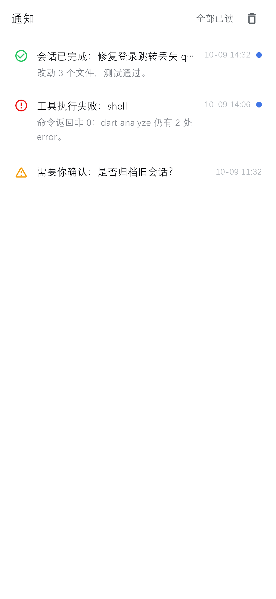
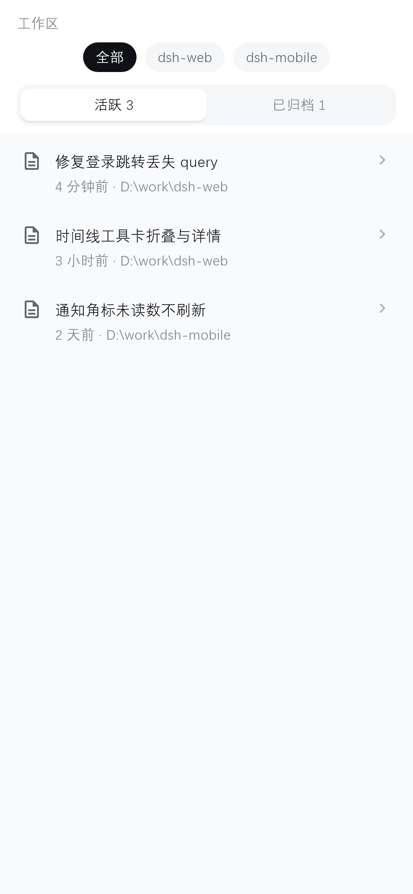
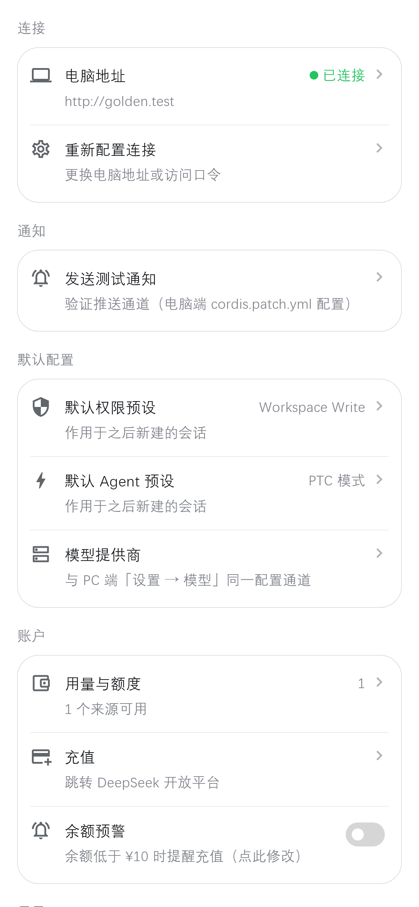
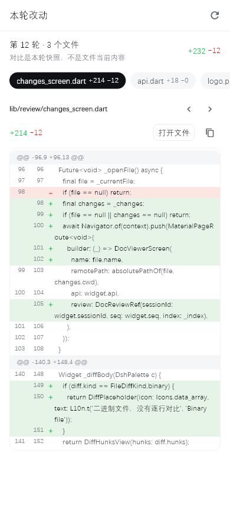
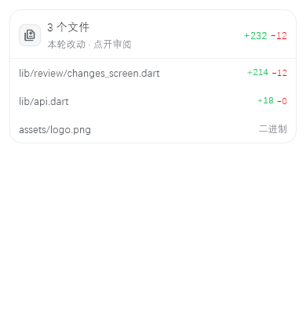

# DSH Remote

**Control your DeepSeek Harness agent from your phone.**

在手机上远程操作电脑上的 DeepSeek Harness agent：派活、看流式进度、收通知、做审批、管会话——电脑开着，人不在桌前也能把活干完。

> 电脑端插件（Node，挂载在 dsh 的 webServer 上） + 安卓原生 App（Flutter）。
> 当前发布：**App `3.2.15+38`** · **插件 `3.1.5-eun.1`** · tag [`v3.2.15`](https://github.com/zhang132212/dsh-mobile-remote/releases/tag/v3.2.15) · MIT
>
> 分支：`main` 安卓发布线 · **`ios` 本分支**（iOS 移植，未发布） · `plugin` 插件源码

| 首页 | 对话 | 通知 |
|---|---|---|
|  |  |  |

| 会话 | 设置 | 改动审阅 |
|---|---|---|
|  |  |  |

深色版与令牌走查图见 [`docs/screenshots/`](docs/screenshots/)；界面规范见 [docs/10-ui-design-system.md](docs/10-ui-design-system.md)。

---

## 1. 为什么需要它

agent 跑在电脑上：读你的仓库、开你的终端、用你的凭据。它一旦进入长任务，人就只能坐在屏幕前等——离开了，进度看不见、审批点不了、追问答不上，活就卡在那里。

DSH Remote 把这一层搬到手机上，但**不复制一份状态过去**：

- 会话、标题、归档、模型、权限预设，全部实时读写电脑端那一份，双端天然一致；
- 手机只做「显示 + 转发决策」，不缓存对话、不重算 diff、不持有凭据；
- 电脑关机、断网、插件被卸载，手机端不会留下"影子会话"，重装后自动恢复。

**不是它要做的事**：不是公网 SaaS，不是云端中转，不是多租户控制台。它是"自己电脑的一块随身屏幕"。

---

## 2. 能力

### 2.1 对话与进度

- 流式回复 + Markdown（标题 / 列表 / 表格 / 引用 / 代码块 / 图片 / 链接）
- 数学公式：TeX 与 OMML 双路解析，就地排版
- token 用量、上下文占用环（70% / 90% 切换警告色）、回到底部浮钮
- 微信式无限上翻：滑到顶自动补更早历史，无断页
- 草稿保留：退出对话再进，输入框里还是刚才那句
- 活动条：思考中 / 正在调用哪个工具，实时一行；思考内容可展开
- 思维链**按步出现**：多步工具调用时，每一步的思考在完成时就落成一折块，而不是等整轮结束才来一波
- 轮次失败原因直接进对话：模型报错时插入错误卡片，原样展示内核给的原因（例如 `402: Insufficient account funds`），不再只剩一句"轮次结束（error）"

### 2.2 审批与提问

agent 中途要你拍板时会弹卡：选选项、填自定义答案、允许一次 / 拒绝。

- 与 PC 端**同一份待办**：任一端先答，另一端自动收卡
- 三档策略 `approvalMode`：`both`（默认，双端同卡）/ `mobile`（手机独占）/ `desktop`（只走桌面）
- 手机离线或双方都无应答 → 超时 fail-close，不会替你做决定
- 取消语义明确：手机点 ✕ = 审批 cancelled / 问询跳过，不会把 `null` 当答案喂给内核

### 2.3 通知

- 通道任选：Server酱、ntfy、Bark、自定义 Webhook（可同时配多个）
- 通知中心按会话聚合，支持单删 / 批量 / 清空、未读角标、点击直达会话
- 同会话同类型 60 秒内合并；`doneGraceMs` 保证多轮大任务不会每个子轮次都推一条"完成"
- 隐私默认收紧：`pushContent: minimal` 只推事件类型 + 会话短码，标题与错误详情不出电脑

### 2.4 会话与配置

- 全部会话：切换、续接、分支（fork）、归档 / 取消归档，按工作区分组
- 新建会话：选 Agent 模式、跨盘浏览目录、就地新建文件夹
- 模型与提供商：与 PC 端同一配置通道，内置提供商可见可配（baseURL + API Key 即激活），按提供商分组、可搜索、可探测可用模型
- 推理强度、权限预设（危险权限需二次确认）、默认 Agent 预设 / 默认权限预设可直接改，作用于之后新建的会话
- 会话工具三页签：后台任务（可取消）/ 子代理（可中断、可点进子会话）/ 目标（创建、暂停、继续、标记完成）
- 消息反馈与命令面板：与 PC 端同源

### 2.5 代码改动审阅

agent 写完代码，对话末尾出现「本轮改动」卡片：改了 N 个文件、增删多少行。

- 点开是逐文件 unified diff：两侧行号、`+` / `−` 标记、增删整行底色、`@@` hunk 头
- 新建 / 删除 / 二进制 / 超过 2 MB / 对比超时，各有明确状态词，不编行数
- 数据来自电脑端的 workspace-changes 服务，与 PC 端改动卡片、review tab 同一份事实；手机只按需读取，不重算
- 文档阅读器里多一个「改动」页签：同一页既能读全文，也能看这一轮改了哪几行



### 2.6 文档阅读

电脑上的文件不用下载到手机再找 App 打开，直接在对话里点开读：

- **Markdown / 纯文本**：按官方 Markdown 阶梯排版，目录跳转
- **HTML**：容错解析成可读版面；需要时切「交互模式」，交给系统 WebView 真跑脚本，按钮 / 表单 / JS 弹窗可用（页面里的相对路径 JS / CSS / 图片从电脑端拉，限定在文档目录内）
- **SVG**：纯 Dart 矢量渲染（含 path 全命令、transform、text），不引第三方库；可展开看源码
- **XML / JSON**：折叠树 + 类型标注，JSONC 容错；超大文档截断并告警
- **Word / Excel**：docx、xlsx 就地读；也能把 Markdown 导出成 docx
- 相对链接、页内锚点、`file:///` 与 Windows 绝对路径都可点，在阅读抽屉里就地打开

### 2.7 用量与额度

- DeepSeek 余额（CNY）、Codex 账户配额、OpenCode Go 的 5h / 每周 / 每月窗口
- 只剩百分比与颜色，不把三个窗口相加，也不参与预警
- 悬浮球面板按需拉取（客户端 2 分钟节流），旧插件整体降级为单行余额

### 2.8 桌面悬浮球（Android）

一只半透明鲸鱼常驻桌面：空闲灰，有任务 / 通知 / 余额偏低时亮蓝加红点。

- 单击开迷你面板（运行中会话 / 通知 / 打开 App / 去充值 / 用量）
- 拖动贴边 5 秒自动缩进，双击开 App，长按退出
- 错过的通知会在浮球上补提示

### 2.9 连接与自检

- 桌面设置页出现「连接移动端设备」：二维码含地址与口令，扫码即连，不用手抄 IP
- 多地址自动切换：局域网、虚拟组网、穿透入口都进候选，按可达性挑一个
- 环境诊断：逐项列出内核服务与端点实测结果，含 `approvalMode` 实际生效语义、双端审批通道是否就绪
- 中 / 英双语，深浅色跟随系统或手动切换

---

## 3. 它是怎么工作的

```
┌──────────────┐   HTTP + SSE   ┌────────────────────────────┐
│  Android App │ ─────────────► │  dsh 进程内的插件（/m）      │
│  Flutter     │ ◄───────────── │  路由 · 认证 · 事件桥 · 推送  │
└──────────────┘                └────────────┬───────────────┘
                                             │ ctx 服务
                                             ▼
                                  ┌────────────────────────┐
                                  │ dsh 内核                │
                                  │ 会话 · agent · 模型 ·   │
                                  │ 审批 · 工作区 · 目标    │
                                  └────────────────────────┘
```

四条设计约束：

1. **单一事实源**：会话数据只在电脑端。手机是视图，不是副本。
2. **能力协商，不猜版本**：`/api/bootstrap` 用 `capabilities` 声明宿主具备什么（事件时间线、改动摘要……）。宿主没挂对应插件，App 就不显示入口、也不发请求，而不是报错。
3. **只加字段，不删协议**：新插件配旧 App、新 App 配旧插件都能跑；未知帧一律忽略。
4. **默认收紧**：认证、跨站防护、事件白名单、错误脱敏都按 fail-closed 实现；拿不准的一律不下发。

---

## 4. 安装

### 4.1 电脑端 · 桌面版（当前主线）

```powershell
# 1) 装插件（tag 锁定版本；也可下载 Release 里的 .tgz 本地安装）
dsh plugin add github:zhang132212/dsh-mobile-remote#v3.2.15
```

在 `cordis.patch.yml` 里启用并配置：

```yaml
- insert:
    - id: mobile-remote
      name: dsh-mobile-remote
      config:
        authToken: "<至少 16 位随机串>"
        lanBridge:
          enabled: true        # 桌面版必开：desktop 的 webserver 只听回环
          port: 3080
          host: 0.0.0.0
```

重启 DSH Desktop → 设置 → **连接移动端设备**，页面上会出现二维码。

> 桌面版的 webserver 被强制绑定在回环地址，手机无法直连；LAN 桥是插件在进程内另起的监听，只转发移动端面（不转发内核 API、不转发二维码数据）。**不要试图覆盖 webserver 的 host**，那条路是封死的。

### 4.2 电脑端 · 命令行 `dsh web`

```powershell
# profile 的 package.json 加依赖
"dsh-mobile-remote": "github:zhang132212/dsh-mobile-remote#v3.2.15"
# 安装
corepack pnpm install
# 启动
npx @deepseek-ai/dsh web
```

命令行形态的 webserver 默认已经监听 `0.0.0.0:3080`，`lanBridge` 可以不开。**若要改端口**，覆盖 webserver 行时必须同时写 `host` 与 `port`，否则启动会报 `$port missing required value`。

### 4.3 手机端

从 [Releases](https://github.com/zhang132212/dsh-mobile-remote/releases/latest) 下载附件里的 `.apk` 安装（允许"安装未知来源应用"）。

自行构建见 [dsh-mobile-app/README.md](dsh-mobile-app/README.md)：`flutter build apk --release`，正式分发需自建 keystore（换签名 = 换应用，用户必须卸载重装并重新扫码）。

### 4.4 建立连接

1. 手机与电脑在同一网络；
2. App 里点「扫码连接」，对准电脑上的二维码（**用 App 内置扫码，别用系统相机**——系统相机会跳浏览器）；
3. 连上后首页直接发消息。

手动输入也支持：地址 `http://<电脑IP>:3080` + 口令。

> Windows 上连不上，九成是防火墙：当前网络被识别成"公用"时会拦入站 3080。把网络配置文件改成"专用"，或管理员执行：
> ```powershell
> netsh advfirewall firewall add rule name="DSH Mobile 3080" dir=in action=allow protocol=TCP localport=3080 profile=private
> ```

### 4.5 不在同一局域网

插件的定位是**可信内网**。外出时用虚拟组网（蒲公英等，实测可用），把电脑的虚拟 IP 当第二个地址填进 App，之后自动切换；穿透方案（frp 等）需把中继域名写进 `trustedHosts`，入口地址写进 `publicUrls` 一并进二维码，并务必配强口令。

**不要把 3080 直接映射到公网。**

---

## 5. 配置

完整示例：

```yaml
- insert:
    - id: mobile-remote
      name: dsh-mobile-remote
      config:
        path: /m
        authToken: "s3cr3t-...-random"
        approvalMode: both
        pushContent: minimal
        pushUrls:
          - name: 微信
            url: https://<uid>.push.ft07.com/send/<sendkey>.send
            format: serverchan
        rateLimit: { maxFailures: 10, windowMs: 60000, blockMs: 60000 }
        lanBridge: { enabled: true, port: 3080, host: 0.0.0.0 }
```

| 字段 | 默认 | 说明 |
|---|---|---|
| `path` | `/m` | 移动页挂载前缀，单段、以 `/` 开头。与别的插件抢前缀时改成 `/mr` 之类，App 会自动适配 |
| `authToken` | 空 | 访问口令。空 = 关闭认证（只信任网络层）；建议 ≥16 位随机串，每台电脑不同 |
| `cookieName` | `dsh_mobile_token` | 认证 cookie 名 |
| `sessionTtlMs` | 30 天 | 登录有效期 |
| `maxConnections` | `16` | SSE 连接数上限（每台手机常驻 1~2 条） |
| `trustedHosts` | `[]` | 额外放行的 Host（穿透/中继场景显式声明，不带端口） |
| `publicUrls` | `[]` | 写进二维码的公网 / 穿透入口，供多设备与外网使用 |
| `pushUrls` | `[]` | 推送通道：`serverchan` / `ntfy` / `bark` / `generic` |
| `pushCooldownMs` | `60000` | 同会话同类通知的最小间隔 |
| `doneGraceMs` | `15000` | agent 转为 idle 后需稳定多久才算"真结束" |
| `pushContent` | `minimal` | `minimal` 只推事件类型 + 短码；`standard` 才含标题与详情 |
| `rateLimit` | `{10, 60000, 60000}` | 登录失败限流（窗口内超限 → 429） |
| `lanBridge` | `{false, 3080, 0.0.0.0}` | 桌面版必开；监听失败或未设口令时拒绝启动 |
| `approvalMode` | `both` | `both` / `mobile` / `desktop` |
| `rechargeUrl` | DeepSeek 充值页 | 「去充值」跳转地址 |

---

## 6. 安全模型

**信任边界**：插件假定手机与电脑之间的网络是可信的（家庭 WiFi、虚拟组网、加密隧道）。它不提供端到端加密，也不做公网暴露面的加固。

已经做的：

- **口令即凭据**：`authToken` 校验后发 cookie，失败按窗口限流；二维码含口令，等于凭据，别截图转发
- **二维码数据不出本机**：`/api/qr-config` 仅允许回环访问
- **LAN 桥最小暴露**：只转发 `${path}` 前缀的移动端面，不转发内核网关与二维码接口
- **非 GET 跨站防护**：`Sec-Fetch-Site` 或来源主机不在允许集 → 403
- **事件白名单**：系统提示词、LLM 请求快照、压缩摘要等内部记录，在历史、实时、详情三处都不下发；详情接口只对显式允许的类型返回原始载荷
- **错误脱敏**：不回传主机绝对路径与内核原始异常
- **上传限制**：单次 ≤ 64 MB，文件名黑名单，无法解析目标会话时直接 404，不会"猜"一个目录写进去
- **fail-closed**：认证、审批、问询超时都倾向"不动作"，而不是替用户放行

需要你自己承担的：强口令、网络隔离、不把端口裸露到公网、定期换口令（换完重启，旧二维码自动作废）。

---

## 7. 兼容性

| 项 | 要求 |
|---|---|
| DSH / 桌面端 | 机制基线 `0.1.2-rc.1`（DSH Desktop v2.0.5）：双端审批走 `$events` 通道 + 瀑布 answerer。更旧的内核自动走帧桥；纯 headless 形态下插件静默不动作 |
| dsh-mobile-remote 插件 | 与 App 版本号独立演进（两端可不同版本）；升级后先跑一次环境诊断，红了就是需要适配的地方 |
| 手机 | Android 7.0+，64 位；Impeller 渲染异常时可在 manifest 关掉回落 Skia |
| 构建 | Flutter 3.35+（Dart SDK `^3.13`）+ Android SDK |
| iOS | **本分支已移植，尚未发布**：iOS 15.0+，需 macOS + Xcode 构建，见 §11 |
| 宿主 | Windows / macOS；命令行与桌面端同一 profile，插件自动加载 |

**版本差不会崩**——协议只加字段：

| 组合 | 结果 |
|---|---|
| 同 Release 的 App + 插件 | 配套发布（两端版本号可以不同） |
| 新插件 + 旧 App | 老功能正常，新功能不可见 |
| 新 App + 旧插件 | 老功能正常，新功能提示升级或直接隐藏入口 |
| 破坏性变更 | 不做 |

发布物里带 `update.json` 签名清单，App 的「检查更新」据此校验版本与 sha256，公钥内置在 `dsh-mobile-app/lib/update/trusted_keys.dart`。

---

## 8. 仓库结构

```
lib/
  index.js                      插件主体：路由、认证、SSE 事件桥、时间线摘要、推送、审批
  client.js                     桌面设置页「连接移动端设备」客户端模块
  account-usage.js              余额 / 配额聚合
  update-crypto.js              更新清单签名校验
  git-read-service.js           Git 只读工作台（按会话授权）
  git-read-bundled-provider.js  内置 git 命令 provider
dsh-mobile-app/                 Flutter App
  lib/screens/                  首页 / 对话 / 会话 / 通知 / 设置 / 用量 / 文档
  lib/review/                   改动卡片、变更审阅页、diff 渲染
  lib/docs/                     文档阅读器（md / html / svg / xml / json / docx / xlsx）
  lib/update/                   自更新（清单、验签、安装）
  android/…/FloatingBubbleService.kt   悬浮球
docs/                           设计、协议、安全、测试、部署文档（见下表）
tools/ test/                    服务端验证脚本与回归测试
prototype/                      早期界面原型
```

### 文档索引

| 文档 | 内容 |
|---|---|
| [docs/01-PRD.md](docs/01-PRD.md) | 需求与产品边界 |
| [docs/02-architecture.md](docs/02-architecture.md) | 架构、事件流、认证链路 |
| [docs/03-api.md](docs/03-api.md) | 全部 `/api/*` 端点与错误码 |
| [docs/04-security.md](docs/04-security.md) | 威胁模型与加固清单 |
| [docs/05-test-cases.md](docs/05-test-cases.md) | 验收用例 |
| [docs/06-install-run.md](docs/06-install-run.md) | 部署细节、穿透方案、签名与打包 |
| [docs/07-user-manual.md](docs/07-user-manual.md) | 使用手册 |
| [docs/08-扩展开发指南.md](docs/08-扩展开发指南.md) | 动作区、自定义推送、二次开发 |
| [docs/09-compatibility.md](docs/09-compatibility.md) | 内核耦合点、降级行为、已知问题 |
| [docs/10-ui-design-system.md](docs/10-ui-design-system.md) | 设计令牌、组件、界面走查 |
| [FAQ.md](FAQ.md) | 连接 / 使用 / 审批 / 设备 / 显示 / 安全速查 |

---

## 9. 开发

**插件端**

```powershell
node --check lib/index.js
node --test test/*.mjs                    # 回归用例
node tools/timeline-contract-check.mjs    # 时间线契约
node tools/account-usage-check.mjs        # 用量归一化
node tools/e2e-check.mjs                  # 端到端冒烟
```

**App 端**

```powershell
cd dsh-mobile-app
flutter analyze                            # 应为 No issues found
flutter test                               # 300+ 用例
flutter build apk --release                # 产物在 build\app\outputs\flutter-apk\
```

**界面走查**：不依赖真机与模拟器，由真实组件渲染 golden 图，直接看版式对不对：

```powershell
flutter test --update-goldens test/ui_gallery_test.dart test/ui_pages_gallery_test.dart
# 产物：test/goldens/，同步到 docs/screenshots/
```

**发布**：`dsh-mobile-app/tools/package-release.ps1` 打包 APK 与插件 tgz，`tools/publish-manifest.mjs` 生成签名清单。

改代码前建议先读 [CONTRIBUTING.md](CONTRIBUTING.md) 与 [docs/09-compatibility.md](docs/09-compatibility.md)：插件与内核的耦合点都在那里列着，绕开它们改动最省事。

---

## 10. 排障

| 现象 | 先看这里 |
|---|---|
| 手机连不上 / 超时 | 电脑上 `http://127.0.0.1:3080/m/api/bootstrap` 是否通；通就是防火墙或网络类别 |
| 扫码成功但一直转圈 | 地址是否被拼成 `/m/m`；`path` 是否与别的插件冲突 |
| 发消息没反应 | 上一轮是否还在跑（消息会排队）；状态点是绿还是橙 |
| 手机不弹审批卡 | 环境诊断看 `approvalMode` / `remoteEvents`；策略是不是 `desktop` |
| 不推送 | `pushUrls` 是否配错、通道是否限流；`pushContent` 是否让你以为内容丢了 |
| 没有改动卡片 | 宿主没挂 workspace-changes，或这一轮确实没改文件 |

更多见 [FAQ.md](FAQ.md)。

---

## 11. iOS（本分支）

iOS 与 Android 共用同一套 Dart 代码，只多一层平台适配。**基线是 `main` 的 v3.2.15**，iOS 侧不复制业务逻辑，只补平台差异。

### 11.1 工程形态

- 完整 iOS 工程在 `dsh-mobile-app/ios/`，**iOS 15.0+**，bundle id `com.dsh.remote`
- Swift Package Manager 集成，**没有 Podfile**，不需要 `pod install`
- UIScene 生命周期（`SceneDelegate` + `UIApplicationSceneManifest`）
- 原生桥只做两件事：`dsh/files`（保存 / 文档选择 / 外部文档打开 / 24 MB 上限 / 后台读 / deliveryId 去重）与 `dsh/update`（iOS 恒不可用）；不实现 `dsh/floating`
- `Info.plist`：相机 / 相册 / 本地网络权限文案，md / txt / docx / xlsx 文档类型，`UIFileSharingEnabled`，ATS 放行任意加载（用户可自填 DSH 地址）

### 11.2 构建（需 macOS + Xcode 16+）

```bash
cd dsh-mobile-app
flutter pub get                            # SPM 集成，无需 pod install
flutter analyze
flutter build ios --release --no-codesign  # 产物 build/ios/iphoneos/Runner.app
flutter build ios --simulator --debug      # 模拟器版
```

签名：Xcode 打开 `ios/Runner.xcworkspace` → Runner target → Signing & Capabilities 选自己的 Team。免费 Apple ID 可侧载（**7 天需重签**）；公开分发走 TestFlight / App Store。

### 11.3 与 Android 的差异（已显式降级）

| 项 | iOS 行为 |
|---|---|
| 系统悬浮球 | 不显示入口；设置页说明「iOS 不支持系统悬浮球，后台提醒请配 Bark 推送」 |
| 后台常驻 SSE | 退后台被挂起，回前台自动重连并补拉；只保证前台实时 |
| App 内自更新 | 入口隐藏；升级走 TestFlight / App Store |
| 文件保存 | 存到「文稿 / DSH-Remote /」（「文件」App 可见），保存时弹系统分享面板；同名自动加「 (n)」 |
| 本地网络权限 | iOS 14+ 首次连局域网弹授权，必须允许；拒绝后首次请求失败一次，App 重试一次并给出设置路径 |

### 11.4 验收与 CI

- `dsh-mobile-app/integration_test/` 在模拟器跑通「冷启动 → 连接页 → mock DSH（SSE）→ 主界面 → 设置页 → 降级文案断言」
- `.github/workflows/ios.yml`：macOS runner（macos-15 / Xcode 16.4 / Flutter 3.47.7）跑 analyze → 全量测试 → 设备版 release 构建 → 模拟器构建与冒烟 → `integration_test`；另起 Android job 回归 release APK；证据回传 `ci-artifacts` 分支
- 已验：设备版 `--no-codesign` 构建（Runner.app ≈ 24 MB / arm64）、模拟器启动与真实渲染、Impeller(Metal) 日志、端到端用例、Dart 全量测试
- **未验（需真机）**：相机扫码、真实局域网直连、分享面板与「用 DSH Remote 打开」交互

### 11.5 上架前加固

自用 / TestFlight 不受影响。公开上架前建议：连接目标校验收紧（二维码目前只做前缀校验）、口令改 Keychain 存储、日志移出 Documents、下载体积上限、docx / xlsx 解压上限、文档解析移入 isolate、补 `PrivacyInfo.xcprivacy`、ATS 审核备注。详见 [docs/09-compatibility.md](docs/09-compatibility.md) §8。

## 12. 许可

MIT © 2026 Polaris。详见 [LICENSE](LICENSE)。
