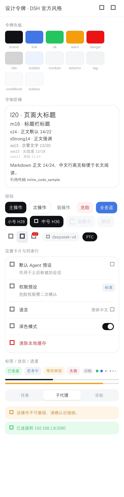
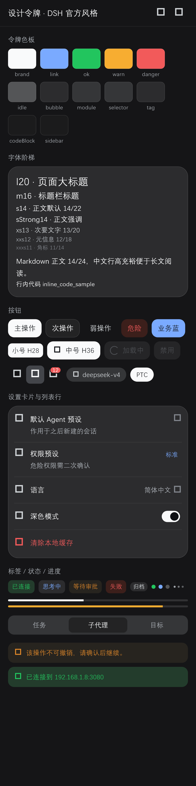
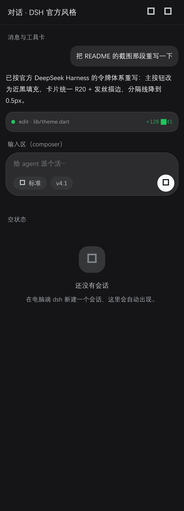

# DSH Remote（dsh-mobile-remote）

> 把 DeepSeek Harness 变成**随身控制台**：手机远程操作电脑上的 agent —— 发消息派活、看进度、收通知、审批决策、管理会话。电脑端跑着，人不在电脑前也能全程操作。
>
> 插件 + 原生 App（**Android 7.0+ / iOS 15.0+**）。iOS 平台差异、构建与验证证据见 [docs/09 §4](docs/09-compatibility.md) 与 [docs/ios-ci.md](docs/ios-ci.md)。

## 目录

- [功能亮点](#功能亮点) · [平台支持与差异](#平台支持与差异) · [截图](#截图) · [架构](#架构)
- **部署**：[前置与版本对齐](#0-前置条件与版本对齐) · [安装插件](#1-安装插件) · [配置](#2-配置cordispatchyml) · [LAN 桥](#3-桌面版lan-桥与防火墙) · [启动与验证](#4-启动与验证命令级) · [手机端](#5-手机端安装与连接) · [更新回滚卸载](#6-更新--回滚--卸载) · [排障](#7-排障) · [部署验证记录](#8-部署验证记录实测)
- [配置项全表](#配置项cordispatchyml) · [推送通知](#推送通知可选) · [iOS 专项](#ios-专项)
- [安全](#安全) · [已知限制](#已知限制) · [兼容性](#兼容性) · [版本与发布](#版本与发布) · [文档](#文档) · [开发](#开发)

## 功能亮点

**远程操作**

- 📱 **发消息 / 派任务**：流式回复、Markdown 渲染（标题/列表/代码块/表格/引用/链接）、token 用量、**微信式无限上翻**（滑到顶部自动加载更早 + 回到底部浮钮）
- ❓ **问询 / 审批弹窗**：agent 中途要你拍板（选选项/输入自定义答案）或工具要权限（允许一次/拒绝）时手机弹卡片；**与 PC 端同一待办，任一端回答两端同步消失**（`approvalMode` 可切双端/手机独占/仅桌面）
- 🛠️ **会话工具**：运行中的后台任务实时卡片（可取消）+ 三页签弹层 —— 任务 / 子代理（查看+中断）/ 目标（查看、创建、暂停、继续、标记完成，与 PC 端 goal 服务同源）
- 👀 **过程可见**：活动条（思考中 / 正在调用工具）+ 可折叠思考面板；普通/调试双模式（调试模式可看原始参数、事件元数据、未知可见事件）
- 💬 **消息操作**：复制、👍/👎 反馈（与 PC 端同源、可取消）、**fork 分支**、斜杠命令菜单（对齐 PC 端 command menu）

**会话与配置**

- 🗂️ **会话管理**：查看/切换/续接全部会话，标题与 PC 端实时同步，按工作区分组（子目录自动归属最近工作区），归档与 PC 端同源
- ➕ **新建会话**：选 Agent 模式（标准/PTC/极简/创造）+ 选工作目录（跨盘浏览、可新建文件夹）
- ⚙️ **配置对齐 PC 端**：模型、推理强度、权限预设（危险权限需风险确认）、**默认 Agent 预设 / 默认权限预设可直接修改**（作用于之后新建的会话）
- 🏢 **模型提供商互通**：与 PC 端「设置 → 模型」同一配置通道 —— 内置 37 个 dormant 提供商（anthropic / openai / google / groq 等）手机可见可配（baseURL + API Key 即激活），模型选择器按提供商分组，可搜索/编辑/探测模型
- 📊 **用量与额度**：DeepSeek / Codex / OpenCode Go 三来源用量与余额（插件 v3.2.0+），余额实时查询 + 充值跳转 + 低余额预警

**通知与连接**

- 🔔 **通知中心 + 系统推送**：完成 / 待回答 / 失败三类通知；推送桥支持 Server酱 / ntfy / Bark / 通用 webhook（同会话同类型自动聚合、可单删/批量/清空）；推送默认只含事件类型 + 会话短码（隐私优先）
- 📶 **扫码连接**：桌面 dsh 设置页出现「连接移动端设备」二维码 → 手机扫码即连（免输 IP/口令）；也支持手动输入
- 🌐 **多地址自动切换**：二维码可带局域网 + 公网/穿透入口（`publicUrls`），App 收集候选地址并按可达性自动切换（蒲公英 / Tailscale 等组网方案可用）

**移动端体验**

- 🫧 **悬浮球（Android）**：透明鲸鱼常驻桌面，空闲灰 / 有任务·通知·余额低亮蓝+红点；单击迷你面板（运行中会话 / 通知 / 打开 App / 去充值），拖动贴边、双击开 App、长按退出（iOS 无此平台能力，见「平台支持与差异」）
- 📄 **文档阅读器**：在 App 内浏览电脑文件并渲染 **md / txt / docx / xlsx**；公式支持（KaTeX 字体渲染 + 导出 Word 原生 OMML 公式）；外部文件可用「用 DSH Remote 打开」直接查看
- 🖼️ **图片链路**：拍照/选图上传、聊天图片渲染与全屏预览
- 🎨 **界面**：与官方 DeepSeek Harness Web 客户端同源的设计令牌，浅色/深色双主题（跟随系统或手动）、中/英语言切换（即时生效）、聊天草稿保留、下拉刷新
- 🩺 **环境诊断**：一键查看当前环境各项能力（服务探针 + 端点实测 + 审批桥状态），升级/排障一目了然
- 🧩 **插件动作区**：第三方插件通过 `mobileActions` 注册的动作自动出现在移动端
- 🔄 **应用内更新（Android）**：Ed25519 签名 manifest 验签 + APK sha256 校验后交给系统安装器（iOS 不支持，走 TestFlight/App Store）

## 平台支持与差异

| 能力 | Android 7.0+ | iOS 15.0+ |
|---|---|---|
| 渲染后端 | Impeller（Vulkan → GLES 自动回退；个别旧机型可切 Skia） | Impeller（Metal，**唯一后端**，不可切 Skia） |
| 系统悬浮球 / 后台常驻 SSE | ✅ 悬浮窗 + 前台服务，App 被杀仍可收事件 | ❌ 平台无此能力；入口隐藏 + 设置页说明；后台提醒用 Bark 推送 |
| App 内自更新 | ✅ 验签后安装 APK | ❌ 走 TestFlight / App Store，或重新签名安装 |
| 文件保存 | 系统「下载」目录（MediaStore，免权限） | App「文稿」目录（文件 App 可见）+ 系统分享面板 |
| 文件选择 / 外部文档打开 | 系统文件选择器 / 分享 intent | UIDocumentPickerViewController；`CFBundleDocumentTypes`（md/txt/docx/xlsx）「用 DSH Remote 打开」 |
| 系统通知 | 通知栏（前台服务通知）+ 推送桥 | App 内通知中心 + 推送桥（无 APNs 集成） |
| 扫码 | CameraX | AVFoundation（首次需相机权限；模拟器无摄像头） |
| 明文 HTTP | `usesCleartextTraffic`（仅限内网） | ATS 放行任意加载（用户可自填任意 DSH 地址）+ 本地网络权限 |
| 签名分发 | 自建 keystore（换签名=换应用） | Xcode 免费账号侧载（7 天重签）/ TestFlight / App Store |

> 平台不可实现项均已**显式降级并给出用户可读说明**（不是静默坏掉），详见 [docs/09 §4](docs/09-compatibility.md)。

## 截图

> App 界面按**官方 DeepSeek Harness Web 客户端**的设计令牌整体重构（配色/圆角/字体/发丝描边/高度同源，见 [docs/10-ui-design-system.md](docs/10-ui-design-system.md)）。下表为重构前真机截图；重构后走查图见下方「界面走查」。

| 首页 | 对话 | 通知 |
|---|---|---|
|  |  |  |

| 会话列表 | 设置 | 新建会话 |
|---|---|---|
|  |  |  |

| 外出访问：蒲公英 App（移动端） | 蒲公英 PC 客户端 | 应用商店搜索 |
|---|---|---|
|  |  |  |

### 界面走查（重构后）

无需真机与模拟器，直接由真实组件渲染出图（`flutter test --update-goldens test/ui_gallery_test.dart test/ui_pages_gallery_test.dart`，产物在 `dsh-mobile-app/test/goldens/`）：

| 首页 | 会话列表 |
|---|---|
|  |  |

| 设置 | 通知 |
|---|---|
|  |  |

| 令牌与组件（浅色） | 令牌与组件（深色） |
|---|---|
|  |  |

| 对话版式（浅色） | 对话版式（深色） |
|---|---|
|  |  |

各页面深色版本见 `docs/screenshots/ui-page-*-dark.png`。

## 架构

```
手机（原生 App，Android/iOS） ──HTTP/SSE──► 电脑上的 dsh 进程（本插件）
                                          │ ctx 服务（agents/sessions/llm/…）
                                          │ /m/api 桥（与 PC 端 GUI 同一协议）
                                          ▼
                                     dsh 内核（会话唯一真源）
```

- **会话唯一真源在 PC 端**：移动端不存状态，实时读写 —— 天然一致，不存在「同步」
- **移动端零插件感知**：核心功能只依赖 dsh 内核语义；个性化（模型/权限/预设/提供商）全部动态读取
- **桌面端 / 命令行双形态兼容**：同一 profile，插件自动加载；桌面版经插件 **LAN 桥**让手机直连回环服务

## 部署

> 本章是从零部署的完整步骤（插件 + 手机 App）；已按本章实测验证，见 [§8 部署验证记录](#8-部署验证记录实测)。

### 0. 前置条件与版本对齐

| 项 | 要求 |
|---|---|
| 电脑 | Windows 10/11 或 macOS；手机与电脑在同一局域网 / 虚拟组网 |
| DSH | **DSH Desktop（桌面版，推荐）** 或命令行 `dsh`（web 版） |
| 手机 | Android 7.0+ / iOS 15.0+（见 [§5](#5-手机端安装与连接)） |

**⚠️ 版本对齐（最容易踩的坑）**：

- `dsh` CLI 版本必须与 profile 的 bundle 版本一致（如 CLI `0.2.1-rc.2` 配 `0.2.1-rc.2` 的 bundle）；不一致时启动报 `ERR_MODULE_NOT_FOUND: @deepseek-ai/dsh-client-ui-*`。
- 本插件的 `peerDependencies` 声明 **DSH 0.1.x 基线**（`>=0.1.0-rc.6 <0.2.0`）。在 **DSH 0.2.x** 上加载器会判定不兼容并**静默禁用插件**（日志 `disabling profile plugin row "mobile-remote"`）。解决方式：
  1. **显式版本豁免**（实测可用）：
     ```bash
     dsh plugin --profile <profile> allow-version dsh-mobile-remote@<插件版本> --dsh-version <dsh版本> --accept-risk
     # 例：dsh plugin --profile web allow-version dsh-mobile-remote@3.1.5-eun.1 --dsh-version 0.2.1-rc.2 --accept-risk
     ```
     豁免只对「精确包版本 + 精确 DSH 版本」生效；`dsh plugin --profile <profile> version-exemptions` 可查看。
  2. 或使用与插件基线匹配的 DSH（0.1.x）。

### 1. 安装插件

#### 方式 A：DSH Desktop（桌面版，推荐）

1. **找到 profile 目录**：Windows `C:\Users\<你>\.dsh\profiles\desktop`；macOS `~/.dsh/profiles/desktop`。
2. **声明依赖**：编辑该目录的 `package.json`，在 `dependencies` 中加入（三选一）：
   ```json
   {
     "dependencies": {
       "dsh-mobile-remote": "github:zhang132212/dsh-mobile-remote#v3.2.10"
     }
   }
   ```
   - 发布 tag（推荐，锁定配套版本）：`github:zhang132212/dsh-mobile-remote#v3.2.10`
   - 本地 clone：`file:D:/path/to/dsh-mobile-remote`
   - 离线安装：下载 Release 的插件 `.tgz`，写 `file:C:/path/to/dsh-mobile-remote-<版本>.tgz`
3. **安装依赖**：
   ```powershell
   cd C:\Users\<你>\.dsh\profiles\desktop
   corepack pnpm install
   ```
4. **启用插件**：编辑同目录 `cordis.patch.yml`，加入 mobile-remote 行（完整示例见 [§2](#2-配置cordispatchyml)）。
5. **重启 DSH Desktop**（插件随进程加载）。
6. **验证**：启动日志出现 `mobile-remote: lanBridge 已监听 0.0.0.0:3080 → 127.0.0.1:<port>/m/api`；桌面设置页出现「连接移动端设备」。

#### 方式 B：命令行 dsh web

1. 同上，编辑 `~/.dsh/profiles/web/package.json` 并 `corepack pnpm install`；
2. `cordis.patch.yml` 加 mobile-remote 行（**web 版 webserver 默认已监听 `0.0.0.0:3080`，无需 LAN 桥**）；
3. 启动：`dsh web`（等价 `dsh --profile web`）；自定义端口/监听地址：
   ```bash
   dsh web --host 0.0.0.0 --port 3080 --no-open
   ```
4. 验证：`curl -s -o NUL -w "%{http_code}" http://127.0.0.1:3080/m/api/bootstrap` → 配置了口令时应为 **401**（说明插件已挂载且鉴权生效）。

#### 方式 C：让 DSH 的 agent 自动安装

把本仓库交给 DSH 的 agent，说：「按 docs/06 安装 dsh-mobile-remote 插件」即可；发布代码请按 Release tag 锁定。

### 2. 配置（cordis.patch.yml）

在 profile 的 `cordis.patch.yml` 追加（字段含义见 [配置项全表](#配置项cordispatchyml)）：

```yaml
- insert:
    - id: mobile-remote
      name: dsh-mobile-remote
      config:
        path: /m
        authToken: <访问口令，建议 ≥16 位随机串；留空=关闭认证>
        # 桌面版必开（手机局域网直连）；web 版默认已监听 0.0.0.0，无需此项
        lanBridge:
          enabled: true
          port: 3080
          host: 0.0.0.0
        pushUrls: []          # 可选：推送通道，见「推送通知」
```

> 口令生成：`node -e "console.log(require('crypto').randomBytes(24).toString('base64url'))"`
>
> ⚠️ **不要覆盖 `webserver` 行**：桌面版 webserver 强制回环（覆盖 host 会报错）；web 版默认已是 `0.0.0.0:3080`，无需覆盖。确要改端口时必须写全必填字段（`host` + `port`），否则启动报 `$port missing required value`（`--dump-config` 测不出来，只有真启动才暴露）。

### 3. 桌面版：LAN 桥与防火墙

> **背景**：DSH Desktop 强制 web 服务只听 `127.0.0.1`，手机无法直连；插件自 v3.0.0 起内置 LAN 桥：在 DSH 进程内再监听一个端口，把 `/m` 前缀请求流式转发到回环 webserver。**未配置 `authToken` 时桥拒绝启动**。

1. 按 [§2](#2-配置cordispatchyml) 开启 `lanBridge` 并重启；
2. 首次监听 `0.0.0.0` 时 Windows 防火墙弹窗点「允许」；或手动放行：
   ```powershell
   netsh advfirewall firewall add rule name="DSH Mobile LAN" dir=in action=allow protocol=TCP localport=3080
   ```
3. 验证桥已工作：
   ```bash
   curl -s -o NUL -w "%{http_code}" -H "x-mobile-token: <口令>" http://<电脑局域网IP>:3080/m/api/bootstrap
   # 期望：200（桥已把请求转发到回环 webserver）
   ```
4. 桥只转发移动端面（`/m` 前缀），不转发 `api` 网关与 `qr-config` / `qr.png`（安全边界）。

### 4. 启动与验证（命令级）

重启 DSH 后逐项验证（`<口令>` 换成配置里的 `authToken`）：

| 检查项 | 命令 | 期望 |
|---|---|---|
| 插件已挂载 + 鉴权生效 | `curl -s -o NUL -w "%{http_code}" http://127.0.0.1:3080/m/api/bootstrap` | `401`（未带口令）；未配口令时 `200` |
| 口令正确 | `curl -s -H "x-mobile-token: <口令>" http://127.0.0.1:3080/m/api/bootstrap` | `200` + JSON（`ok` / `plugin.version` / `server.urls`） |
| LAN 桥（桌面版） | `curl -s -o NUL -w "%{http_code}" -H "x-mobile-token: <口令>" http://<电脑局域网IP>:3080/m/api/bootstrap` | `200` |
| 二维码数据（桌面设置页用） | `curl -s http://127.0.0.1:3080/m/api/qr-config` | `200` + `{ok,urls,token,path}`（**仅本机可访问**） |
| 二维码图片 | `curl -o qr.png "http://127.0.0.1:3080/m/qr.png?text=test"` | `200`、`image/png` |
| SSE 事件流 | `curl -N -H "x-mobile-token: <口令>" http://127.0.0.1:3080/m/api/events` | 首帧 `: connected`，随后 `data: {"type":"hello",...}` |
| Host 白名单 | `curl -s -o NUL -w "%{http_code}" -H "Host: evil.example" http://127.0.0.1:3080/m/api/bootstrap` | `403` |
| 环境诊断（App） | App → 设置 → 环境诊断 | 各项 ✅ |

### 5. 手机端安装与连接

**Android**：从 [GitHub Releases](https://github.com/zhang132212/dsh-mobile-remote/releases/latest) 下载 `apk` 安装，或自行构建（见 [开发](#开发)）。

**iOS**：经 TestFlight / App Store，或 Mac + Xcode 自行签名安装（见 [iOS 专项](#ios-专项)）。

**连接步骤**：

1. 桌面 dsh 设置页 →「连接移动端设备」→ 显示二维码（含地址+口令）；
2. 手机 App →「扫码连接」扫该二维码（或手动输入 `http://<电脑地址>:<端口>/m` + 口令）；
3. 首次连接 iOS 会弹「本地网络」权限，**必须允许**；拒绝后到 设置 → 隐私与安全性 → 本地网络 放行；
4. 连上后首页即可发消息派活。

> 人不在家：用蒲公英 / Tailscale 等虚拟组网（已实测），或按 [docs/06 §5](docs/06-install-run.md) 配置穿透（需 `trustedHosts` + 强口令 + TLS）。

### 6. 更新 / 回滚 / 卸载

| 操作 | 步骤 |
|---|---|
| 更新插件 | 改 `package.json` 里的 tag/路径 → `corepack pnpm install` → 重启 DSH；口令未变时无需重扫二维码 |
| 回滚插件 | `cordis.patch.yml` 删除 mobile-remote 行 → `package.json` 删除依赖 → `corepack pnpm install` → 重启；插件路由/SSE 随进程释放，桌面 GUI 不受影响 |
| 更新 App（Android） | 同签名 APK 覆盖安装，连接信息保留；换签名需卸载重装并重扫 |
| 更新 App（iOS） | TestFlight / App Store，或重新签名安装 |
| 卸载 | 同「回滚插件」；App 直接卸载即可（会话数据在电脑端，不受影响） |

### 7. 排障

| 现象 | 原因 | 解决 |
|---|---|---|
| `curl /m/api/bootstrap` 返回 404 | 插件未加载（依赖未装/未重启/`path` 改错） | 检查 profile `node_modules/dsh-mobile-remote`、重启 DSH、核对 `path` |
| 日志 `disabling profile plugin row "mobile-remote"` | DSH 版本超出插件 peer 范围 | 按 [§0](#0-前置条件与版本对齐) 做 `allow-version` 豁免，或换匹配版本 DSH |
| 启动报 `ERR_MODULE_NOT_FOUND: @deepseek-ai/dsh-client-ui-*` | `dsh` CLI 与 profile bundle 版本不一致 | 升级/对齐 DSH CLI 与 profile 版本 |
| 桌面设置页二维码报错 / `qr-config` 500 | v3.2.5–v3.2.10 的已知 bug（`publicEntrances` 作用域越界） | 升级到含修复的版本（本分支已修复，见 [§8](#8-部署验证记录实测)） |
| 手机连不上（超时） | 防火墙拦截 / 不同网段 / LAN 桥未开 / iOS 本地网络权限未允许 | 放行端口、确认同网段/组网、开 LAN 桥、iOS 设置放行 |
| 手机连上但加载不出对话 | 候选地址含不可达的 webserver 回环地址（旧版 bug） | 升级插件；确认 `server.urls` 是 LAN 桥/穿透地址 |
| 403 `host-not-allowed` | 经中继访问但未声明 `trustedHosts` | 把中继域名/IP 写入 `trustedHosts` |
| 429 `rate-limited` | 口令错误次数过多（默认 10 次/60s 封 60s） | 等待窗口结束；核对口令 |
| 启动报 `$port missing required value` | 覆盖了 `webserver` 行且字段不全 | 删除该覆盖行（推荐），或写全 `host` + `port` |
| 端口被占用 | 3080 已被其它服务使用 | 改 `lanBridge.port`（web 版改 webserver 端口），手机地址同步改 |

### 8. 部署验证记录（实测）

> 2026-10-24 按本章步骤在隔离测试 profile 上完整走了一遍；详细证据见 `ios-port/deploy-test/`。

| 项 | 实测结果 |
|---|---|
| 环境 | Windows 11 · Node 24.16 · DSH **0.2.1-rc.2**（`D:\dsh-remote` CLI） |
| 安装 | 新建测试 profile → `corepack pnpm install`（30 个包，10.6s）→ `cordis.patch.yml` 配置 → `dsh --profile deploy-test --host 127.0.0.1 --port 3096 --no-open` |
| 版本兼容 | DSH 0.2.x 需 `allow-version` 豁免（否则插件被静默禁用）；豁免后插件正常加载 |
| bootstrap（无口令） | ✅ `401` |
| bootstrap（带口令） | ✅ `200`（`ok=true`，`plugin.version=3.1.5-eun.1`，`server.urls` 含 LAN 桥地址） |
| LAN 桥转发（0.0.0.0:3091 → 回环 3096） | ✅ 无口令 `401` / 带口令 `200` |
| 二维码数据 `/m/api/qr-config` | ✅ `200`（`{ok,urls,token,path}`）——**测试中发现并修复了 500 bug** |
| 二维码图片 `/m/qr.png?text=` | ✅ `200` `image/png`（2470 bytes） |
| Host 白名单 | ✅ 非法 Host 返回 `403` |
| SSE `/m/api/events` | ✅ `: connected` + `data: {"type":"hello",...}` |
| 手机真机连接 | ⚠️ 未在本机验证（无真机接入本次测试实例）；协议层已验证 |

**本次测试发现并修复的 bug**：`/m/api/qr-config`（桌面设置页「连接移动端设备」二维码数据）在 v3.2.5 之后返回 **500** —— `publicEntrances` 函数被定义在 `/bootstrap` 分支内部，`/qr-config` 引用时抛 `ReferenceError`。已将其提升到 `handleApi` 作用域、两个端点共用；修复后复测 `200`。

## 配置项（`cordis.patch.yml`）

| 字段 | 默认值 | 说明 |
|---|---|---|
| `path` | `/m` | 移动端挂载路径（单段、以 / 开头；不能是 `/`） |
| `authToken` | 空 | 访问口令，空=关闭认证（建议 ≥16 位随机串） |
| `cookieName` | `dsh_mobile_token` | 认证 cookie 名 |
| `trustedHosts` | `[]` | 额外可信 Host（内网穿透/中继场景显式声明） |
| `publicUrls` | `[]` | 写进配对二维码的公网/穿透入口（多设备、外网可用） |
| `sessionTtlMs` | 30 天 | 登录会话有效期 |
| `rechargeUrl` | DeepSeek 充值页 | 充值入口跳转地址 |
| `maxConnections` | 16 | SSE 连接数上限 |
| `pushUrls` | `[]` | 推送通道列表（name/url/format），见「推送通知」 |
| `pushCooldownMs` | 60000 | 同会话同类型推送节流 |
| `doneGraceMs` | 15000 | 「对话真正结束」判定宽限（避免多轮任务刷通知） |
| `pushContent` | `minimal` | 推送内容级别：`minimal` 只含事件类型+会话短码；`standard` 含标题/详情 |
| `rateLimit` | 10 次/60s → 封 60s | 登录失败限流（仅启用 authToken 时） |
| `lanBridge` | 关闭 | 桌面版局域网桥（enabled/port/host；未配口令拒绝启动） |
| `approvalMode` | `both` | 审批/问询呈现：`both` 双端 / `mobile` 手机独占 / `desktop` 仅桌面 |

## 推送通知（可选）

不配置则无系统推送，其余功能不受影响；可同时配置多个通道（事件推送到全部通道）。同会话同类型 60 秒内合并（`pushCooldownMs` 可调），通知中心按会话聚合。

| format | 通道 | 说明 |
|---|---|---|
| `serverchan` | Server酱（微信） | 免费版每天限 5 条 |
| `ntfy` | ntfy（安卓通知栏） | 手机安装 ntfy App 并订阅主题 |
| `bark` | Bark（iPhone） | 手机安装 Bark App 复制 key |
| `generic` | 通用 webhook | POST JSON：`{kind,title,detail,sessionId,time}` |

```yaml
pushUrls:
  - name: 微信
    url: https://<uid>.push.ft07.com/send/<sendkey>.send
    format: serverchan
  - name: iPhone
    url: https://api.day.app/<你的key>
    format: bark
```

> **隐私（v2.6+）**：默认 `pushContent: minimal`，推送只含「事件类型 + 会话短码」，会话标题/错误详情等核心内容不经过第三方通道；确需完整内容（信任通道时）设 `standard`。

配置步骤与验证方法见 [docs/06 §6](docs/06-install-run.md)。

## 可选：IM 入口（dsh-im）

想「在微信里直接给 agent 说话派活」？本插件不内置 IM 机器人（那是另一层协议）。可另装独立的 DeepSeek Harness 插件 **[@xmanrui/dsh-im](https://github.com/xmanrui/dsh-im)**（支持微信 / 飞书 / 钉钉 / 企业微信 / QQ / Slack / Telegram / Discord / WhatsApp 等）：

- **dsh-im**：IM 对话入口（在微信里聊天派活、收回复）；
- **本插件**：手机控制台（进度 / 审批 / 会话管理）+ 干活完成提醒（推送桥，不依赖 App 常驻后台）。

装法（电脑端）：`dsh plugin add @xmanrui/dsh-im` → 微信扫码登录；完成提醒走本插件推送桥（见「推送通知」）。

## iOS 专项

> iOS 端与 Android 共用同一套 Dart 代码，只补平台差异层。**最低 iOS 15.0**，bundle id `com.dsh.remote`，显示名 `DSH Remote`。

### 工程形态

- Flutter 3.47 模板：**Swift Package Manager（SPM）集成，无 Podfile / 无需 `pod install`**；
- **UIScene 生命周期**（`SceneDelegate` + `UIApplicationSceneManifest`，Xcode 27 / iOS 27 SDK 起 Apple 强制要求）；
- 原生桥（Swift）实现 `dsh/files`（保存/文档选择/外部文档打开/24MB 上限/后台读/deliveryId 去重）与 `dsh/update`（iOS 恒不可用）；不实现 `dsh/floating`；
- `Info.plist`：相机/相册/本地网络权限文案、md/txt/docx/xlsx 文档类型、`UIFileSharingEnabled`、ATS 放行任意加载（理由：用户可自填任意 DSH 地址）。

### 构建（需 macOS + Xcode 16+）

```bash
cd dsh-mobile-app
flutter pub get                               # SPM 集成，无需 pod install
flutter analyze
flutter build ios --release --no-codesign     # 验证构建；产物 build/ios/iphoneos/Runner.app
flutter build ios --simulator --debug         # 模拟器版（冒烟用）
```

### 签名与安装

1. Xcode 打开 `ios/Runner.xcworkspace` → Runner target → Signing & Capabilities 选自己的 Team；
2. 连 iPhone 运行。免费 Apple ID 可侧载（**7 天需重签**）；公开分发走 TestFlight / App Store（需付费开发者账号）。

### 平台差异（不可实现项，已显式降级）

| 项 | iOS 行为 |
|---|---|
| 系统悬浮球 | 不显示入口；设置页说明「iOS 不支持系统悬浮球；后台提醒请配置 Bark 推送」 |
| 后台常驻 SSE | 退后台被挂起；回前台自动重连并补拉。只保证前台实时 |
| App 内自更新 | 入口隐藏；版本升级走 TestFlight / App Store |
| 文件保存 | 保存到 App「文稿」（`Documents/DSH-Remote/`，「文件」App 可见），用户主动保存/导出时弹系统分享面板；同名文件自动加「 (n)」后缀 |
| 本地网络权限 | iOS 14+ 首次连接局域网会弹系统授权，**必须允许**；拒绝后首次请求会失败一次，App 自动重试一次并显示设置路径引导 + 「重试」按钮 |

### 已验证范围（CI 证据）

- **构建**：设备版 release `--no-codesign` 成功（Runner.app 约 24 MB / arm64）；模拟器版 debug 构建成功；
- **运行**：iOS Simulator 安装启动、连接页真实渲染、Impeller(Metal) 日志实证、进程存活；
- **端到端**：`integration_test` 在模拟器跑通「冷启动 → 连接页 → 连 mock DSH 服务(SSE) → 主界面 → 设置页 → iOS 降级文案断言」；
- **测试**：全量 Dart 测试通过（macOS CI + 本机 Windows 双端）；
- **Android 回归**：CI 上 release APK 构建成功，Dart 侧改动未破坏 Android。

**未验证（需真机）**：相机扫码、真实局域网/组网直连、文件分享面板与「文件 App 用 DSH Remote 打开」交互、真机性能数字（无 iPhone 设备）。

### CI（GitHub Actions）

仓库内置 [.github/workflows/ios.yml](.github/workflows/ios.yml)：push 到 `ios/port` 或手动触发，跑 **macOS runner**（macos-15 / Xcode 16.4 / Flutter 3.47.7）：

1. `ios` job：analyze → 全量测试 → 设备版 release 构建 → 模拟器版构建 → 模拟器冒烟（截图/首帧/Impeller）→ `integration_test`；
2. `android` job（ubuntu，非阻塞）：release APK 回归；
3. `report` job：汇总证据并回传 **`ci-artifacts`** 分支（无需 GitHub token 即可取回日志/截图/设备版 .app 归档）。

取回证据：

```bash
git fetch origin ci-artifacts
mkdir -p ci-artifacts-out && git archive FETCH_HEAD | tar -x -C ci-artifacts-out
```

详细说明（触发方式、runner 版本、本地等价复现、排障表、已知限制）见 [docs/ios-ci.md](docs/ios-ci.md)。当前 iOS 移植分支 `ios/port`、验收 tag `ios-port-v4`。

### 上架前加固清单

自用 / TestFlight 不受影响；公开上架前建议处理（详见 [docs/09 §8](docs/09-compatibility.md)）：连接目标校验（二维码目前仅前缀校验）、口令改 Keychain 存储、日志移出 Documents、下载体积上限、docx/xlsx 解压上限、文档解析移入 isolate、补 `PrivacyInfo.xcprivacy`、ATS 审核备注。

## 安全

- **访问口令（`authToken`）是唯一凭据**：每台电脑用不同口令；二维码含口令，勿截屏转发；怀疑泄露立即更换（改配置重启后二维码自动更新，旧码作废）。
- **仅限局域网 / 可信内网**：禁止将 3080 端口直接映射/穿透到公网（需要公网访问请用组网/加密隧道，见 [docs/04-security.md](docs/04-security.md)）。
- `/m/api/qr-config`（桌面二维码数据）仅允许电脑本机读取；LAN 桥只转发 `/m` 前缀。
- iOS ATS 放行任意加载是为了支持用户自填任意 DSH 地址（局域网/组网/自建 http）；Android 同理放行明文 HTTP。**不要**把服务暴露到不可信网络。

## 已知限制

- 移动端默认以普通模式展示时间线与工具活动摘要；调试模式可看原始参数/结果/事件元数据。系统提示词、请求快照与压缩摘要不呈现；旧服务端未保存的详情会明确显示不可用。
- agent 处理上一轮时继续发消息会**排队**（dsh 机制），移动端会提示「正在处理上一轮」。
- 新建会话选的工作目录不在任何已注册工作区时，PC 端按「未分组」显示；在工作区子目录下会自动归属。
- 归档（archive）会话与 PC 端同源；通知删除只清记录不「静音」（同会话同类新事件仍会产生新通知）。
- 问询/审批链路随内核版本走对应机制：0.1.2-rc.1+ 为 Agent 作用域瀑布 + 插件 answerer（`both` 双端呈现走内核 `$events` 远程事件通道）；更早内核走 `apiProxy` 帧桥（私有协议，未来大版本可能断桥，插件干净降级）。手机不弹时先跑环境诊断看 `approvalMode` / `remoteEvents`。
- **iOS 平台限制**：无系统悬浮球、后台不常驻、无 App 内自更新、文件保存到 App 文稿、首次局域网连接需允许「本地网络」——均已显式降级并给出提示，详见 [docs/09 §4](docs/09-compatibility.md)。
- **与 `dsh-web` 的移动端远程（`@linxin666/dsh-remote-web-ui`）同装会冲突**：两者默认都挂 `/m`；共存时给本插件配 `path: /mr`（任意非 `/m` 单段）并重启，App 自动适配无需重装。

## 兼容性

- **dsh 版本**：v3.1.2/v3.1.3 基线为 **`0.1.2-rc.1` 服务包 = DSH Desktop v2.0.5**（approval/request 瀑布 answerer、`$events` 远程事件双端审批、RPC 网关、桌面浏览器门禁适配）；v3.0.0–v3.1.1 基线 **`0.1.1-rc.2` = DSH Desktop v2.0.2**（桌面版强制回环 → LAN 桥）。更低版本按功能降级，详见 [docs/09](docs/09-compatibility.md)。
- **App 平台**：Android 7.0+ 全品牌（实测小米 17 Pro Max）；**iOS 15.0+**（Impeller 唯一后端；SPM + UIScene；平台差异见 docs/09 §4）。
- **桌面平台**：Windows / macOS；命令行 `dsh web` 与桌面端均支持（纯 headless 形态插件静默无操作）。
- **个性化**：模型 / 权限 / Agent 预设 / 模型提供商动态读取 PC 端真实配置，用户自定义自动出现；第三方动作经 `mobileActions` 注册自动上架。
- **深度魔改 web profile**（禁用标准服务）：对应功能自动降级、不崩溃，诊断页可查每个服务状态。

## 版本与发布

- **分离版本**：App 版本由 `dsh-mobile-app/pubspec.yaml` 定义，插件版本由根目录 `package.json` 定义，两者独立演进；Release/git tag 标识一组配套发布代码。
- 当前正式 Release **[v3.2.10](https://github.com/zhang132212/dsh-mobile-remote/releases/tag/v3.2.10)** 对应 **App `3.2.10+33` + 插件 `3.1.5-eun.1`**；从同一 Release 下载 `apk` 与插件 `tgz`（以附件实际名称为准）。
- **iOS 移植**：分支 **`ios/port`**，验收 tag **`ios-port-v4`**（CI 全绿：设备版构建 / 模拟器冒烟 / integration_test / 全量测试 / Android APK 回归）。
- **版本差矩阵**（一句话：谁旧谁吃亏，但都不崩）：

| 组合 | 结果 |
|---|---|
| 同一 Release 的 App + 插件 | ✅ 配套发布（两端版本号可以不同） |
| 插件新 + App 旧 | ✅ 老功能正常，新功能不可见（协议只加不删，未知帧忽略） |
| App 新 + 插件旧 | ✅ 老功能正常，新功能提示升级 |
| 破坏性变更 | ❌ 禁止 —— 已发布接口只加字段（docs/08 约定） |

- 实际配对可在 App **设置 → 关于 → 版本**（`App vX · 插件 vY`）或环境诊断页对照。

## 文档

| 文档 | 内容 |
|---|---|
| [README.md](README.md) | 项目总览：功能、安装、配置、iOS、注意事项 |
| [FAQ.md](FAQ.md) | 常见问题速查（连接 / 使用 / 安全 / 弹窗 / iOS / 设备） |
| [CHANGELOG.md](CHANGELOG.md) | 版本历史 |
| [CONTRIBUTING.md](CONTRIBUTING.md) | 贡献指南 |
| [docs/00-开发总纲.md](docs/00-开发总纲.md) | 产品规划、阶段划分、决策记录 |
| [docs/01-PRD.md](docs/01-PRD.md) ~ [docs/07-user-manual.md](docs/07-user-manual.md) | 需求 / 架构 / API / 安全 / 测试 / 部署 / 手册 |
| [docs/08-扩展开发指南.md](docs/08-扩展开发指南.md) | 二次开发：动作区、自定义推送、页面/App 定制 |
| [docs/09-compatibility.md](docs/09-compatibility.md) | 兼容性：内核耦合、降级行为、多品牌 / iOS、已知问题、签名、上架加固 |
| [docs/10-ui-design-system.md](docs/10-ui-design-system.md) | 界面设计系统：令牌、组件、golden 走查 |
| [docs/ios-ci.md](docs/ios-ci.md) | iOS CI：触发、runner、证据取回、本地复现、排障 |
| [docs/formula-markup.md](docs/formula-markup.md) | 公式标记与导出（OMML）说明 |
| [docs/eun-mobile-fixes.md](docs/eun-mobile-fixes.md) | 移动端历史修复记录 |

## 开发

### 仓库结构

```
lib/index.js        插件服务端：路由 / 认证 / SSE 事件桥 / catalog / 会话 / 通知 / 动作 / 推送 / LAN 桥
lib/client.js       桌面 GUI 客户端模块（设置页「连接移动端设备」二维码）
lib/account-usage.js 用量与额度归一化（DeepSeek / Codex / OpenCode Go）
lib/update-crypto.js 应用内更新验签（Ed25519 manifest）
test/               插件 Node 测试（node --test）
tools/*.mjs         验证脚本（e2e / phase1 / push / 用量 / timeline 契约 / WSL 路径等）
tools/ios-ci/*.sh   iOS CI 脚本（构建 / 冒烟 / 证据回传）
.github/workflows/ios.yml  iOS + Android 回归 + 证据回传 CI
docs/               00–10 设计/接口/安全/兼容文档 + ios-ci
prototype/          早期界面原型（现行视觉以 docs/10 为准）

dsh-mobile-app/     Flutter 原生 App（Android / iOS）
  lib/main.dart            入口：主题 / 抽屉导航 / 连接页 / 外部文档入口
  lib/api.dart             API 客户端（/m/api 全接口 + SSE 解析）
  lib/store.dart           全局状态 + SSE 事件桥（重连退避 / 断线补拉）
  lib/platform_support.dart 平台能力判定 + 文件通道封装（iOS 降级）
  lib/theme.dart           DeepSeek 设计令牌（与官方 Web 客户端同源）
  lib/md.dart / timeline.dart / dsh_kit.dart  Markdown、时间线、基础组件库
  lib/screens/             首页 / 对话 / 会话 / 通知 / 设置 / 文档 / 用量 / 提供商 / 弹层
  lib/docs/                文档阅读器（md / docx / xlsx / 渲染 / 导出）
  lib/math/                公式解析与 OMML 导出
  lib/update/              Android 应用内更新（验签 / 下载 / 安装）
  lib/floating.dart        Android 悬浮球桥
  test/                    单元 / Widget / golden 测试
  integration_test/        iOS 模拟器端到端冒烟
  tools/make_icon.py       Android 图标生成（iOS 用 tool/ios/generate_app_icons.py）
```

### 常用命令

```bash
# 插件测试（Node 20+；开发机验证 24.x）
node --test test/*.test.mjs

# Flutter：分析 + 测试（Windows/macOS 均可）
cd dsh-mobile-app && flutter analyze && flutter test

# Android 构建
flutter build apk --release

# iOS 构建（仅 macOS + Xcode）
flutter build ios --release --no-codesign
flutter build ios --simulator --debug
```

> 本机中文路径下 `flutter analyze` 的 analysis server 可能因 LSP 解析崩溃（Flutter 3.47 / Windows），可改用 `dart analyze` 或把工程放在 ASCII 路径下；CI 在 ASCII 路径运行 `flutter analyze --no-pub` 正常。
>
> 插件测试会 `import lib/index.js`，需要能解析 `@deepseek-ai/*` peer 依赖（在已部署 profile 的 node_modules 环境下，或先 `corepack pnpm install` 装好 peer）；纯 clone 直接跑 `node --test` 会报 `ERR_MODULE_NOT_FOUND`。

### 图标

- 改 `dsh-mobile-app/assets/icon-1024.png` → 运行 `python tools/make_icon.py` 生成 Android 各密度图标；
- iOS：运行 `python tool/ios/generate_app_icons.py` 生成 AppIcon（15 尺寸，无 alpha）+ LaunchImage。

## 许可

[MIT](LICENSE)
